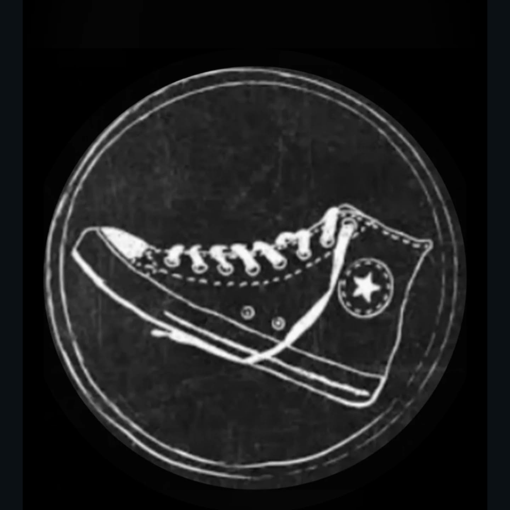
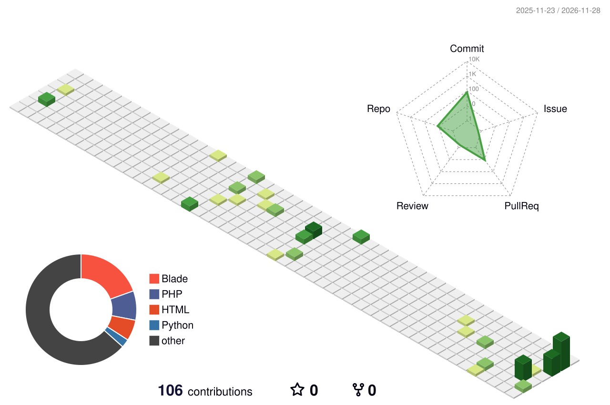

<!-- ===================== HEADER ===================== -->
<div align="center">



<h1>Juliansah Khoirul Umam</h1>

<a href="https://github.com/Joell014">
  
</a>

<br/><br/>

[](https://github.com/Joell014?tab=followers)
[](https://github.com/Joell014?tab=repositories)
[](https://github.com/Joell014)

</div>

<br/>

<!-- ===================== TENTANG ===================== -->

## about me


```js
const Pengguna = {
  nama: "Juliansah Khoirul Umam",
  lokasi: "Tuban, Jawa Timur",
  keahlian: ["Microsoft Excel", "Microsoft Word", "Olah Data"],
  sedangDipelajari: ["Python", "JavaScript", "HTML", "CSS"],
  tujuan: "Menggapai Cita-Cita Dan Masa Depan Yang Baik dan Indah ",
  terbukaUntuk: ["Kolaborasi", "Belajar bersama", "Diskusi seru"],
  motto: "Only a habit can change everything in this world",
};
```

<br clear="right"/>

<!-- ===================== SKILL ===================== -->

## Skills & Technology

<div align="center">

**🔭 Sedang dipelajari**


**Already mastered**


**🧰 Tools**


</div>

### Learning Progress

| Skill              | Level                                                                 |
| :----------------- | :-------------------------------------------------------------------- |
| 📊 Microsoft Excel |    |
| 📝 Microsoft Word  |    |
| 🐍 Python          |  |
| 🌐 HTML & CSS      |  |
| ⚡ JavaScript      |  |

<!-- ===================== PROYEK ===================== -->

## my project

### 📚 Perpustakaan Digital

Sistem informasi koleksi buku berbasis web, lengkap dengan halaman **daftar buku** serta fitur **masuk** dan **daftar** akun.

<div align="center">

<a href="https://deploy-perpustakaan25-012.vercel.app/">
  
</a>
<a href="https://github.com/Joell014/Deploy.Perpustakaan">
  
</a>

<br/><br/>

<a href="https://github.com/Joell014/Deploy.Perpustakaan">
  
</a>

</div>

> 🔜 Proyek berikutnya sedang dalam proses. Stay tuned!

<!-- ===================== STATISTIK ===================== -->

## 📈 GitHub Statistics

<div align="center">


<br/>


<br/><br/>


</div>

<!-- ===================== SNAKE ===================== -->

## Snake

<div align="center">
  <picture>
    <source media="(prefers-color-scheme: dark)" srcset="https://raw.githubusercontent.com/Joell014/Joell014/output/github-contribution-grid-snake-dark.svg" />
    <source media="(prefers-color-scheme: light)" srcset="https://raw.githubusercontent.com/Joell014/Joell014/output/github-contribution-grid-snake.svg" />
    
  </picture>
</div>

<!-- ===================== 3D CONTRIB ===================== -->

## Contribution Graph

<div align="center">
  <picture>
    <source media="(prefers-color-scheme: dark)" srcset="https://raw.githubusercontent.com/Joell014/Joell014/output/profile-night-view.svg" />
    <source media="(prefers-color-scheme: light)" srcset="https://raw.githubusercontent.com/Joell014/Joell014/output/profile-green-animate.svg" />
    
  </picture>
</div>

<!-- ===================== LAYANAN ===================== -->

## What can I do for you

- 📊 Merapikan & mengolah data di **Excel** (rumus, tabel pivot, laporan)
- 📝 Menyusun & memformat dokumen **Word** (laporan, surat, proposal)
- 💬 Diskusi dan belajar bareng seputar dasar-dasar **coding**

<!-- ===================== QUOTE ===================== -->
<div align="center">


</div>

<!-- ===================== KONTAK ===================== -->

## contact person

<div align="center">

[](mailto:jku8765@gmail.com)
[](https://github.com/Joell014)

<br/>

<i>"Only a habit can change everything in this world"</i>


</div>
